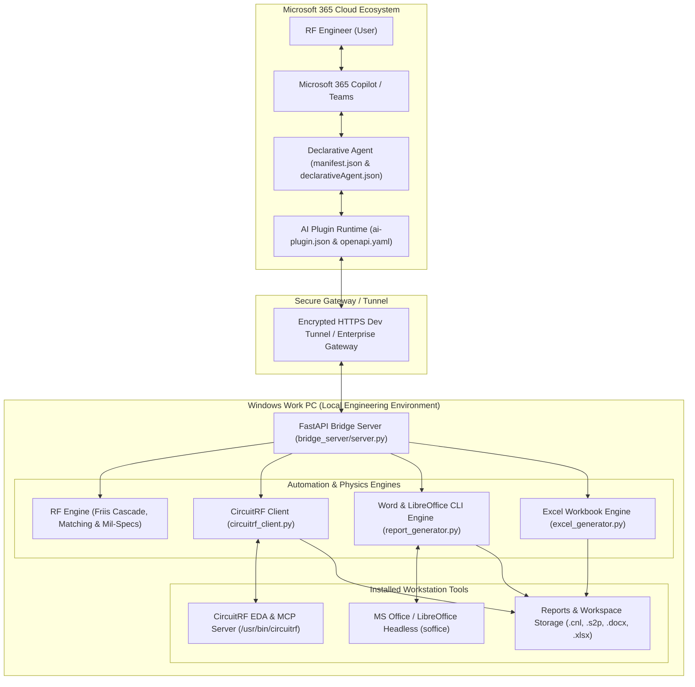

# CircuitRF Microsoft 365 Copilot Agent: System Architecture

This document describes the architectural topology, data boundaries, and execution flow of the **CircuitRF Aerospace & Defence Engineering Copilot Agent**.

---

## 1. High-Level System Architecture

---

## 2. Core Architectural Components

1. **Microsoft 365 Declarative Agent Package**:
   - `manifest.json`: Defines the Teams/M365 integration identity, icons, permissions, and plugin capabilities.
   - `declarativeAgent.json`: Defines the system prompt (Expert Aerospace & Defence RF Engineer persona), conversation starters, and action references.
   - `ai-plugin.json` & `openapi.yaml`: Maps natural language intents to RESTful API endpoints.

2. **FastAPI Bridge Server**:
   - Acts as the interface between the Microsoft Cloud orchestrator and local workstation engineering binaries.
   - Converts REST action invocations into CircuitRF CLI commands, RF matrix operations, and office document builders.

3. **CircuitRF Client & Solver**:
   - Directly executes `circuitrf check` and `circuitrf run analysis=sparam`.
   - Reads and writes CircuitRF `.cnl` netlists and Touchstone `.s2p` datasets.
   - Includes fallback numerical ABCD matrix cascade calculations for robust standalone operation.

4. **Document & Spreadsheet Generation Subsystem**:
   - **Word (`.docx`)**: Generates structured technical memoranda with executive summaries, component tables, embedded Matplotlib frequency plots, and engineering sign-off blocks.
   - **LibreOffice CLI (`soffice`)**: Converts `.docx` to `.pdf` headlessly when required.
   - **Excel (`.xlsx`)**: Generates multi-sheet workbooks with conditional color formatting for compliance matrices, stage-by-stage cascaded budgets, and high-density Touchstone S-parameter data tables.

---

## 3. Data Privacy and Security Boundary
- **Local Circuit Synthesis**: Netlists and RF proprietary intellectual property (e.g. radar/EW schematics) remain strictly on the local host workstation.
- **Controlled Telemetry**: Only high-level parameter summaries (e.g., center frequency, bandwidth, min S11, max S21, noise figure) are exchanged across the Copilot Action boundary.
- **Enterprise Network Isolation**: Dev Tunnels and local bridge servers can be constrained to corporate VPN or internal loopback subnets.
